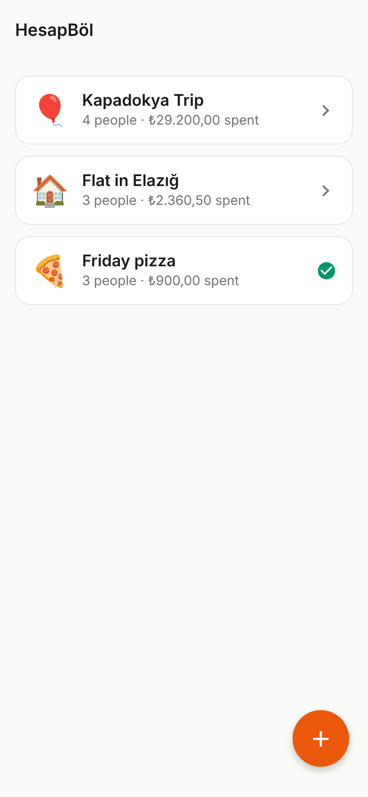
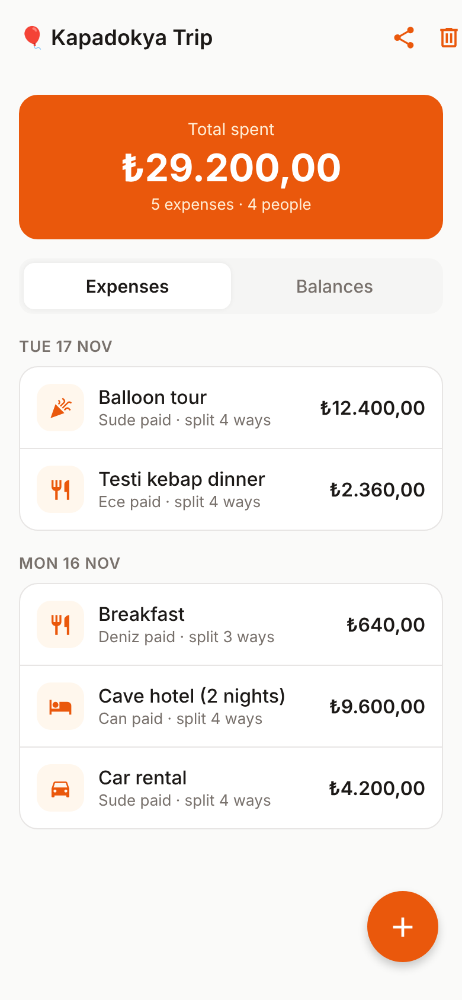
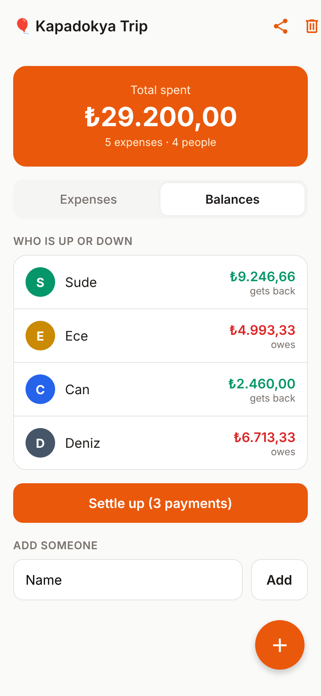
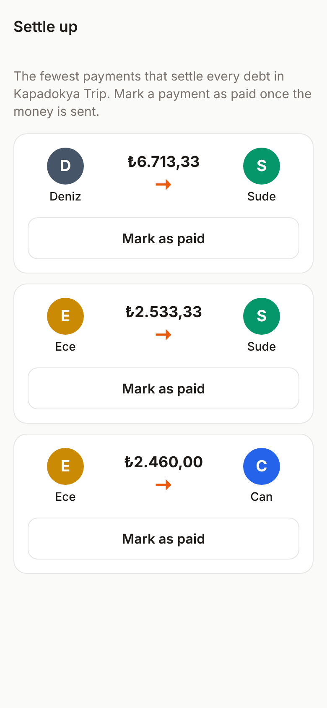
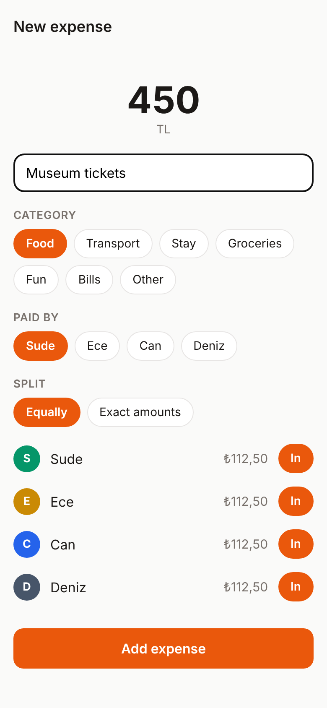

# HesapBöl

A mobile app for splitting shared expenses: a trip with friends, a shared flat, a dinner. Everyone adds what they paid, HesapBöl keeps the balances and shows the fewest payments needed to settle up.

Built with React Native, Expo and TypeScript. Works fully offline; data stays on the device.

| Groups | Expenses | Balances | Settle up | New expense |
| --- | --- | --- | --- | --- |
|  |  |  |  |  |

## Features

- Create groups with an icon and any number of people
- Add expenses with a category and who paid
- Split **equally** between selected people or by **exact amounts**, with live validation that shares add up to the total
- **Balances:** who gets money back and who owes, per person
- **Settle up:** suggested payments that clear every debt with as few transfers as possible; mark them as paid or undo
- Edit and delete expenses, add people later, share a text summary through the system share sheet
- Data is saved on the device with AsyncStorage

## Tech stack

- React Native 0.81, Expo SDK 54, Expo Router (file-based navigation, modals)
- TypeScript in strict mode
- State with `useReducer` + Context, persisted to AsyncStorage
- Vitest for the business logic, GitHub Actions CI

## The interesting parts

### Money as integers

All amounts are stored in kuruş (1 TL = 100 kuruş) as integers. With floating point numbers, `0.1 + 0.2` is `0.30000000000000004`, and those errors add up in balances. The user can type `12,50` or `12.50`; [`toKurus()`](src/lib/money.ts) turns both into `1250`.

### Splitting without losing a kuruş

100 TL between 3 people isn't 33.33 × 3 (that's 99.99). [`splitEqually()`](src/lib/split.ts) gives the leftover kuruş to the first people, so the shares are 33.34 + 33.33 + 33.33 and always add up exactly.

### Fewest payments to settle up

Paying back every expense separately can mean many small transfers. [`simplifyDebts()`](src/lib/balances.ts) works on net balances instead:

1. Compute each person's balance: what they paid minus their shares, adjusted by payments already made. The balances of a group always sum to zero.
2. Repeatedly let the person who owes the most pay the person who is owed the most, as much as possible.

Every step brings at least one person to zero, so a group of *n* people needs at most *n − 1* payments, no matter how many expenses there are.

### State

All changes go through a single pure [`reducer`](src/store/reducer.ts), which makes them easy to test. The provider loads groups from AsyncStorage on start and saves them shortly after changes (debounced), so the UI never waits for storage.

## Project structure

```
app/                         # screens (Expo Router)
├── index.tsx                # group list
├── new-group.tsx            # modal
└── group/[id]/
    ├── index.tsx            # expenses and balances
    ├── expense.tsx          # add / edit expense (modal)
    └── settle.tsx           # suggested payments
src/
├── lib/                     # money, split and balance logic + tests
├── store/                   # reducer and AsyncStorage provider
├── components/ui.tsx        # Button, Chip, Card, Avatar
└── theme.ts
```

## Running

```bash
npm install
npm start          # scan the QR code with Expo Go, or press i / a for a simulator
npm test
```

## Possible next steps

- Sync groups between phones with a backend
- Multiple currencies with exchange rates
- Receipt photos
